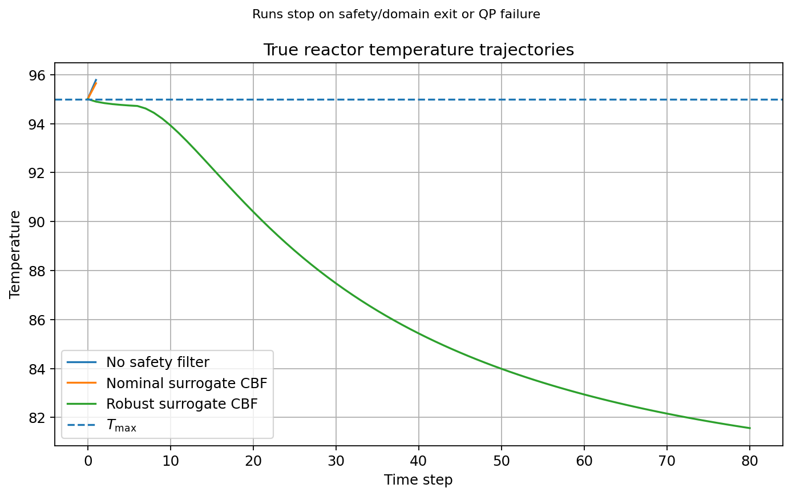
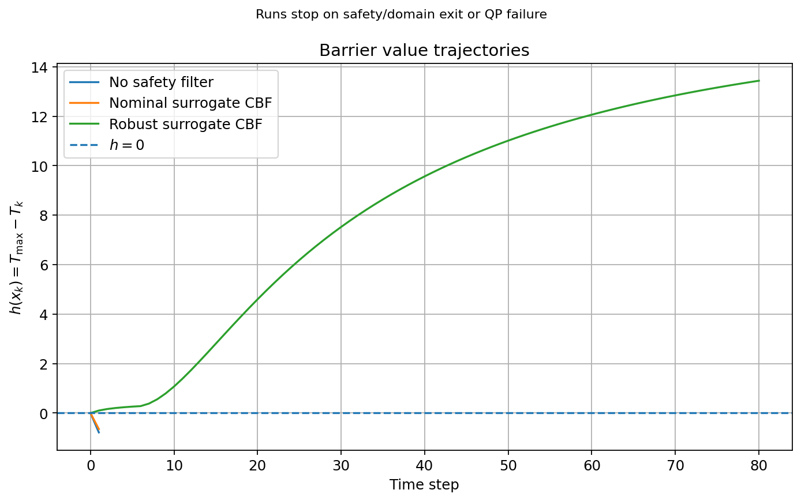
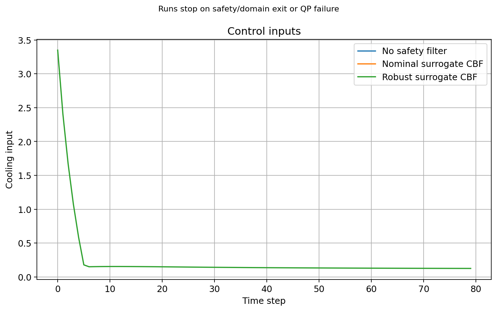
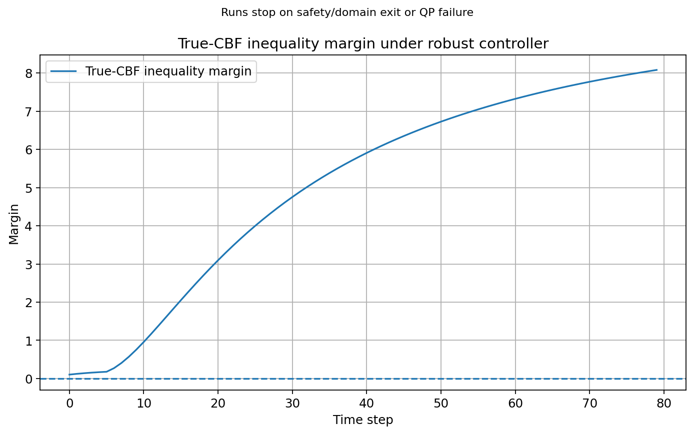

# Robust CBF Demo

An illustrative discrete-time safety-control experiment using
a simplified CSTR-like thermal model, CVXPY, and OSQP.

The experiment compares:
- A desired controller without a safety filter
- A nominal-model control barrier function (CBF) filter
- A robust CBF filter accounting for bounded model mismatch

This is a numerical demonstration, not a validated industrial
reactor model or a deployment-ready safety system.

## Setup

Python 3.12 was used for the recorded experiment.

```bash
python3 -m venv .venv
source .venv/bin/activate
python -m pip install -r requirements.txt
```

## Run

```bash
python experiment.py
```

For a non-interactive run on macOS or Linux:

```bash
MPLBACKEND=Agg python experiment.py --no-show
```

The default experiment saves metrics, trajectories, and four
figures to `results/`. Existing output files are overwritten.

## Model and Safety Constraint

The state contains concentration C and temperature T.
The scalar input u represents cooling actuation.

```text
F(x, u) = F_hat(x, u) + d(x)

d(x) = [0, 0.35 + 0.20*sin(0.09*T)^2 + 0.10*C]

h(x) = 95 - T
```

The assumed model domain is:

```text
C in [0, 2]
T in [60, 95]
u in [0, 4]
```

On this domain, the specified mismatch satisfies:

```text
||d(x)|| <= 0.75
```

This bound follows from the chosen simulator expression.
It is not estimated from experimental data.

The nominal filter enforces:

```text
h(F_hat(x, u)) >= (1 - gamma) * h(x)
```

The robust filter enforces:

```text
h(F_hat(x, u)) >= (1 - gamma) * h(x) + 0.75
```

Here gamma = 0.6. Each filter minimizes the squared deviation
from the desired input, subject to its CBF constraint and input limits.

## Recorded Results

Initial state: [1.8, 95.0].
Requested horizon: 80 steps.
Sampling interval: 0.10.

| Controller | Status | Completed steps | Maximum recorded temperature |
|------------|--------|----------------:|-----------------------------:|
| No filter | Safety violation | 1 / 80 | 95.783201 |
| Nominal CBF | Safety violation | 1 / 80 | 95.647781 |
| Robust CBF | Completed | 80 / 80 | 95.000000 |

Runs stop on safety violation, domain exit, or QP failure.
The violating next state is retained in the recorded trajectory.
No fallback input is applied after termination.

The controllers therefore have different recorded horizons.
Their trajectory-wide sums should not be compared as equal-horizon
performance measures.

The robust run starts on the temperature boundary, so its minimum
barrier value is zero.









## Infeasible Boundary Case

For the initial state [2.0, 95.0], the robust QP is infeasible
under the configured input limits.

The experiment records:
- Status: infeasible
- Completed steps: 0
- No fabricated control input or next state

Being inside the temperature-safe domain does not imply that
the robust CBF constraint is feasible everywhere in that domain.

## Saved Results

- `metrics.json`: configuration, termination status, and metrics
- `*_trajectory.npz`: recorded states, controls, barrier values,
  and constraint margins
- Four PNG figures

Metrics cover recorded samples only. Temperature excess sample sums
are not violation durations; input-square sums are not physical energy.

## Tests

```bash
python -m pip install -r requirements-dev.txt
python -m pytest -q
```

Eight test cases check:
- Model mismatch bounds on sampled domain points
- QP solutions against an independent scalar analytic solution
- Robust trajectory constraints and input limits
- Infeasible termination without fabricated steps
- Unsafe termination while retaining the violating state

## Limitations

- The model and mismatch are synthetic.
- The default comparison uses one initial state and a finite horizon.
- Numerical checks do not establish safety for all initial states.
- Recursive feasibility and invariance of the full model domain
  are not established.
- QP failure terminates the simulation; no recovery controller is included.
- Optional grid analysis is exploratory and has not been fully validated.
- Dependency versions are not yet pinned.